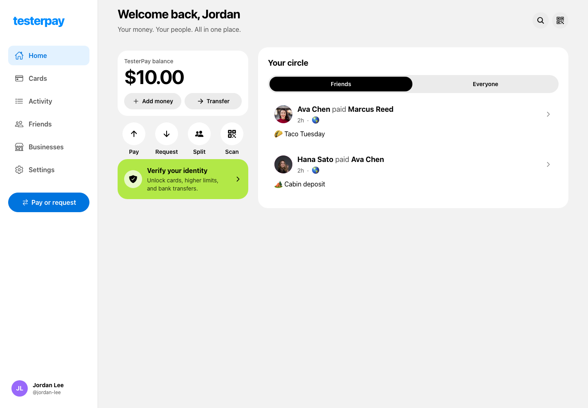
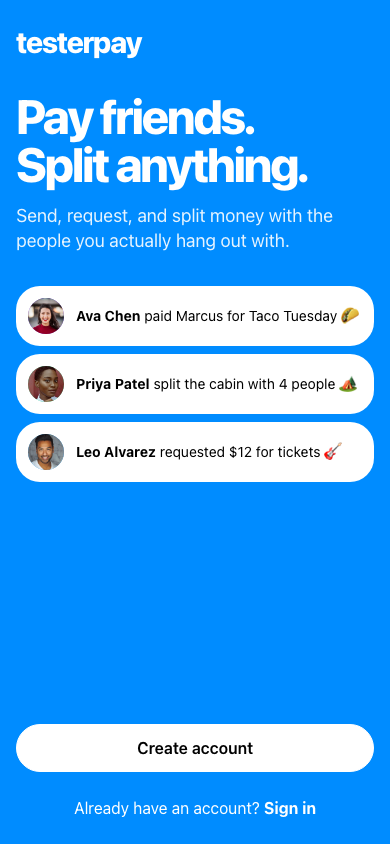
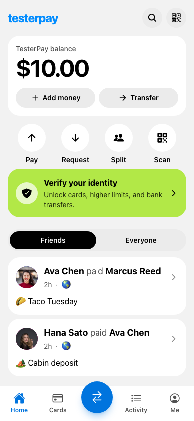
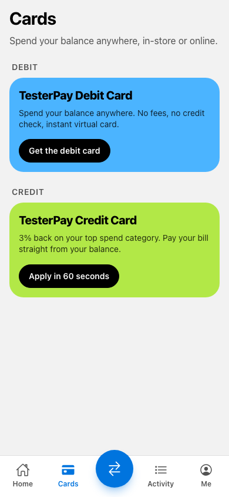
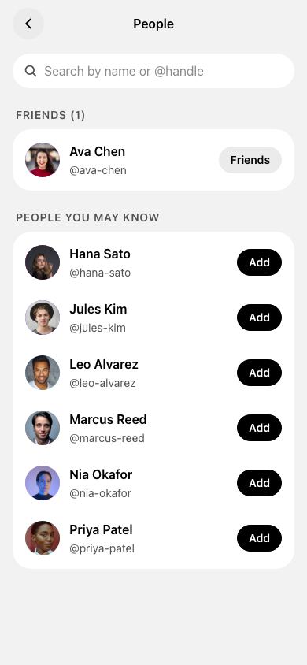

# TesterPay (Next.js)

A Next.js 16 rebuild of the TesterPay demo (`~/testerarmy/demos/apps/finance`), a Venmo-style
payments app used as a QA target.

```bash
npm install
npm run dev   # http://localhost:3000
```

## Screenshots



<p>
  
  
  
  
</p>

## How it works

- **No network backend.** The original Hono + SQLite backend runs in the browser
  (`lib/backend`). Data is stored per visitor in IndexedDB (`demo-finance`), with Web Locks
  keeping tabs in sync. It needs HTTPS or localhost.
- `lib/api.ts` calls the local backend at `https://demo.local`. No request ever leaves the page.
- The session token lives in `localStorage` (`testerpay.session-token`). Route access by session
  status is enforced client-side in `components/app-shell.tsx`, which mirrors Expo's
  `Stack.Protected` groups.
- UI, copy, `data-testid`s, query params, validation and known quirks match the original 1:1.
  The desktop sidebar layout switches on at a width of 960px or more.
- "Reset demo" in Settings restores the seed data.
